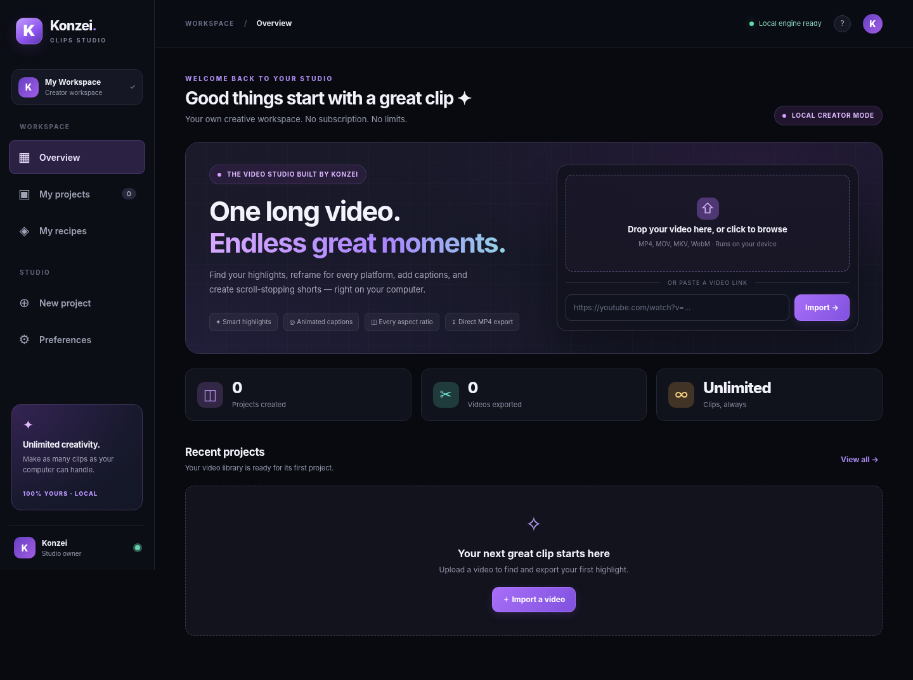

# Konzei Clips

> **Website hosting / GitHub auto-updates:** See [WEB-DEPLOY.md](WEB-DEPLOY.md) for the Docker + Railway starter (v1.2).

**An independent video-to-shorts studio built by Konzei.** The app runs locally in your browser and processes your own videos with FFmpeg. No OpusClip account, payment, license key, or token system is required. It does not modify OpusClip or use their paid backend.



## Quick start on Windows

1. Install **Python 3.11 or 3.12** from [python.org](https://www.python.org/downloads/) and enable **Add Python to PATH**.
2. Install **FFmpeg**, including FFprobe. In Windows Terminal or PowerShell: `winget install Gyan.FFmpeg`. Close and reopen the terminal so PATH refreshes.
3. Extract the ZIP file into a normal folder (for example `C:\KonzeiClips`).
4. Double-click **`start-windows.bat`**. The first launch installs the Python dependencies into a private `.venv` folder.
5. Visit **http://127.0.0.1:8765**. Keep the black terminal window open while using the studio.

If the launcher reports missing Python or FFmpeg, run `python --version` and `ffmpeg -version` in a new terminal and confirm both work.

### Mac / Linux

Install Python 3.11+ and FFmpeg (`brew install ffmpeg`, or `sudo apt install ffmpeg`), then run:

```bash
chmod +x start-mac-linux.sh
./start-mac-linux.sh
```

### Add local AI captions (optional, strongly recommended)

The default installation is usable for manual trimming, scene/audio-based highlight suggestions, cropping, audio cleanup and exports *without downloading any models*. For accurate **automatic spoken-word captions**, install an optional open-source speech recognizer:

**Windows (while inside the Konzei folder):**

```powershell
.venv\Scripts\python.exe -m pip install faster-whisper
```

**Mac/Linux:**

```bash
.venv/bin/python -m pip install faster-whisper
```

Restart Konzei. On the first transcription, the `base` Whisper model will be downloaded; following runs reuse the cached model. This is local CPU transcription. To use the smaller/faster model, set `KONZEI_WHISPER_MODEL=tiny`; for higher accuracy choose `small` (requires more RAM and CPU). Automatic word-timed captions and keyword-based highlight ranking only work after this optional installation.

### Add link imports (optional)

`yt-dlp` is included in `requirements.txt` starting with Konzei Clips v1.0.1. For older installs, install it in the same virtual environment:

```powershell
.venv\Scripts\python.exe -m pip install yt-dlp
```

Links from YouTube, Vimeo, Twitch, Rumble, and Dailymotion are accepted where downloading is permitted and the provider's extraction method still works. Some sites may block unauthenticated imports. You can always upload a local video file instead.

### YouTube says "Sign in to confirm you're not a bot" (v1.0.2)

1. Open YouTube in Chrome, Edge, Firefox, Brave or Vivaldi, sign into **your own** YouTube account, and ensure the video plays.
2. On Konzei's home screen, paste the URL. Under **YouTube login**, choose the same browser. If you have multiple browser profiles, enter its profile *folder* (such as `Profile 1`) in the optional input; otherwise leave it blank.
3. Import again. Konzei passes the selected browser to yt-dlp's `cookiesfrombrowser` option. Cookies are accessed locally for that request and never saved or transmitted to Konzei servers (there are no Konzei servers). YouTube naturally receives authentication in requests, and yt-dlp itself handles the cookies.
4. If you get a browser database locked error, close the browser completely and retry. If you receive an access/decryption error, try Firefox and sign into YouTube there. YouTube's restrictions change; authentication does not guarantee a download.

Test the login directly from the Konzei folder in PowerShell:

```powershell
.\.venv\Scripts\python.exe -m pip install -U yt-dlp
.\.venv\Scripts\python.exe -m yt_dlp --cookies-from-browser chrome --simulate "https://www.youtube.com/watch?v=KCMLPxwlEkI"
```

You can replace `chrome` with `edge`, `firefox`, or another supported browser. **Never post or share browser cookie exports**—cookies grant account access. Use this only for videos you have permission to download. This app does not bypass paid content access or YouTube's anti-bot security checks.


## Features that actually work

| Feature | How it works | Notes |
|---|---|---|
| Local video projects | Upload local video files and manage project history | MP4, MOV, MKV, WebM, M4V, AVI and MPEG |
| Import from supported video URLs | `yt-dlp` downloader | Installed with app; provider-dependent |
| Find moments automatically | Scene-change, audio energy and optional transcript keyword heuristics | Scores are **not** OpusClip's proprietary virality scoring |
| AI transcription | Open-source `faster-whisper` running locally | Optional install and one-time model download |
| Word-synced captions | Animated karaoke, bold, neon, classic and minimal burned-in subtitle styles | Transcript or manually entered text required |
| Caption profanity mask | Replaces selected caption words with asterisks | Doesn't mute source audio |
| Smart face focus | OpenCV face detection samples source frames to choose crop position | Fallback to centered crop when no face found |
| Resize / reframe | FFmpeg output in 9:16, 1:1, 4:5, 16:9 | Fill-and-crop, blurred backdrop, or fit |
| Video trimming | Input editable precise start and end points | Up to 15 minutes per exported clip |
| Intro title | Text overlaid onto first 3.5 seconds | Configurable per export |
| Audio cleanup | Denoise, compressor and loudness normalization | May take extra processing time |
| Silence removal | Finds quiet gaps and shortens **both** video and audio to keep them in sync | Best on talking-head footage |
| Fade | Short audio/video fade in and out | Optional per export |
| MP4 export | Full H.264 video, AAC audio, fast-start playback | No watermark, no credits |
| Batch export | Exports all discovered highlight candidates | Same editor preset applied to all clips |
| Recipes | Save and reuse export settings | Local JSON storage |
| SRT transcript export | Download a plain subtitle file from transcription | Requires Whisper transcription |

## Usage

1. Drag a video to the home screen or click the import area.
2. Open the project and select **Discover → Find highlights**, choosing count and clip length; optional text instructions work best with Whisper transcription.
3. Click a suggested moment to load its start/end times into **Editor**. Or enter the times manually.
4. Choose your aspect ratio, crop style, caption style, audio cleanup options and title. For no-model installation, **turn captions off** or enter manual captions.
5. Select **Export clip**, then **Watch** or **Download** in the Export tab. To export all suggested moments using the same settings, choose **Export all** on Discover.
6. Click **Save recipe** in the editor to reuse your favorite look.

## What this is *not*

The uploaded OpusClip dashboard source is a public-facing HTML shell with references to minified JavaScript; it does **not** include OpusClip's proprietary editing engines. This is therefore a **fresh, independently implemented alternative**, not a binary-identical replica. It does **not** include proprietary multimodal ClipAnything/ReframeAnything models, social-account OAuth/publishing, virality trend data, AI-generated B-roll, voice dubbing, cloud team collaboration, analytics, AI motion graphics, automatic music selection, or Premiere/DaVinci project exports. Such features need substantial separate implementations or integrations. No UI control falsely claims to provide them.

## Files and privacy

The server binds to **127.0.0.1**, so it is available only on your computer by default. Source videos and exports are saved in `data/uploads` and `data/exports`. Project metadata is saved in `data/projects`, and recipes in `data/presets.json`. Deleting a project removes its source file and associated clips. Video imports from URLs and the first Whisper model download involve external connections; local editing does not.

FFmpeg is CPU-intensive for 1080p+ footage. For a first test, use a short, small video. Keep a copy of your original source files.

## Developer commands

```bash
python -m pip install -r requirements.txt
python app.py
# http://127.0.0.1:8765
```

Code: FastAPI + plain JavaScript/CSS frontend + local FFmpeg + optional faster-whisper and yt-dlp. Local HTTP API docs are at `http://127.0.0.1:8765/docs`.

## Brand and credit

**Konzei Clips** — built by Konzei. Independently designed; not affiliated with, endorsed by, or connected to OpusClip.

## v1.1 — Private Google accounts and Konzei owner role

### Before you launch

Google sign-in requires you to register **your own application** with Google. It cannot be completed without a Google OAuth Client ID for the app's origin. No Google password is ever collected by Konzei.

1. Open the [Google Cloud Console](https://console.cloud.google.com/apis/credentials). Create or select a Google Cloud project, configure the Google Auth Platform / OAuth consent screen, and create an **OAuth client ID** of type **Web application**.
2. Add `http://127.0.0.1:8765` to the **Authorized JavaScript origins** (add `http://localhost:8765` too if you use that address). There is no redirect URI for this popup-based sign-in.
3. Copy `.env.example` to `.env`. Replace `YOUR_CLIENT_ID.apps.googleusercontent.com` with your **real** Web Client ID, and set `KONZEI_OWNER_EMAIL` to your own verified Gmail address. **The .env file must stay private and should never be published or shared in an app ZIP.**
4. If the Google OAuth app is in **Testing** mode, add any accounts that need to log in under **Test users** in Google Cloud's Auth Platform settings. Google may also require a configured consent screen. Restart Konzei after editing `.env`.
5. Launch `start-windows.bat` or `python app.py`, then use **Continue with Google**. Your verified owner Gmail gets a hidden **Owner dashboard** entry; all other registered accounts get the standard **user** role.

**PowerShell copy command:** `Copy-Item .env.example .env` then open `.env` in Notepad and fill in the real values. Never share the completed `.env` file.

### How private accounts work

- The server verifies the Google-signed ID token against the configured Client ID, and only accepts verified email accounts. A local SQLite database (`data/accounts.sqlite3`) stores the Google account's stable ID, name, email, profile picture URL, role, and timestamps. **Konzei does not store Google passwords, Google access tokens or Google ID tokens.**
- Google account IDs, email addresses, and other member information are not exposed via any public website pages. The user can see only their own profile; only the real owner can list other registered users in the protected owner dashboard.
- Authentication sessions are created with high-entropy random tokens in HttpOnly SameSite cookies. Only the session's SHA-256 hash and expiration are stored in the database. Sessions expire after 14 days; sign-out revokes that session. Disabling a user revokes all of their sessions.
- Every project, video preview, export, clip/job status, and saved recipe is checked server-side against its owner. Projects and recipes from **v1.0.x** are visible **only to the verified Konzei owner** on upgrade, so ordinary sign-ins cannot access older unassigned media.
- **Owner-only controls** include signup policy, a member announcement, owner statistics, member directory, and enable/disable account access. They remain protected by server checks even if someone manually edits the browser UI.
- When the owner email signs in for the first time, the server binds owner access to that Google account's immutable ID. Merely copying the email into a browser request cannot grant owner access. If the Gmail account is lost, resetting the owner binding requires administrator control over the database.
- Account details and videos remain on **the computer/server that runs the app**, not in a Google Cloud account or any public Konzei service. The SQLite file is not encrypted at rest. Protect server access, filesystem permissions and backups. The Google picture URL may load an image from Google.

### Production or website deployment

The launcher still runs on `127.0.0.1`, so **it is not a public website** without your own server and domain. To deploy privately, configure an HTTPS proxy, production environment configuration, persistent data storage, access logs and backups. Add `https://your-domain.example` as a Google **Authorized JavaScript origin** and set these values in your **server-only** `.env`:

```dotenv
KONZEI_PUBLIC_MODE=1
KONZEI_HOST=127.0.0.1
PORT=8765
```

Keep the Python app behind the HTTPS proxy (do not expose its plain-HTTP port publicly). `KONZEI_PUBLIC_MODE=1` forces Secure session cookies and disables the yt-dlp `cookies-from-browser` local machine feature: the remote server must never use a user's request to read the host computer's browser cookies. Uploading local videos continues to work. Google sign-in is separate from YouTube download authorization and does **not** automatically sign yt-dlp into YouTube.

If you use a public-facing Konzei service, you are responsible for providing appropriate privacy notices, retention/deletion processes and security monitoring. This v1.1 local project is **not** an audited, scaled cloud production service.
